

  <a href="https://ujjwal-portfolio-nu.vercel.app">
    
  </a>
    
  <a href="https://ujjwal-portfolio-nu.vercel.app">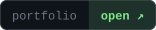</a>
  <a href="https://www.linkedin.com/in/ujjwal-singh-b142302a3/">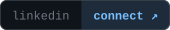</a>
  
  <a href="https://ujjwal-portfolio-nu.vercel.app">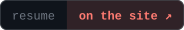</a>
    
  <!-- plain-text intro, readable even where images don't load -->
  <strong>Ujjwal Singh</strong> · ujjwalsingh-1521 
  <strong>Data Scientist + AI Engineer</strong> at <strong>Spectatr.ai</strong>: applied ml, evaluation pipelines, llm product features 
  owns <strong>swiftlist</strong> end to end · re-architected the <strong>pulse</strong> highlight pipeline (10× faster) 
  <em>started in operations with no ml background. taught myself, shipped, kept shipping.</em>

 

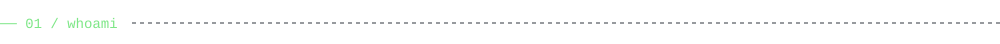

  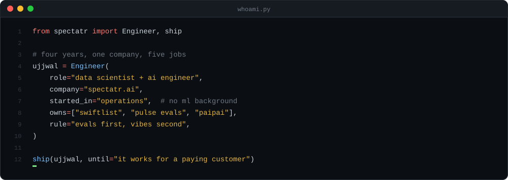

 

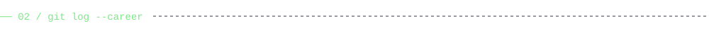

  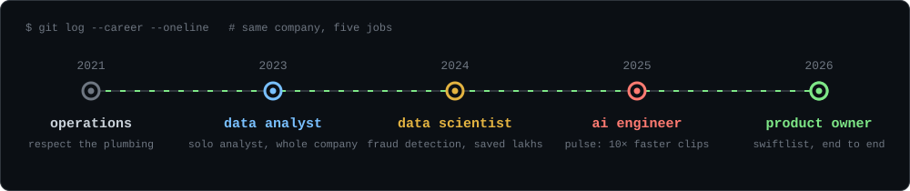

 

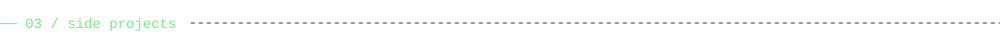

Built on my own time.

  <a href="https://ujjwal-portfolio-nu.vercel.app">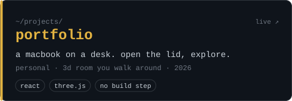</a>
  <a href="https://github.com/ujjwalsingh-1521/paipai">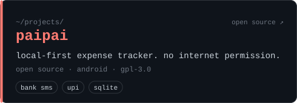</a>

 

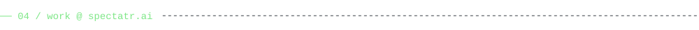

What I built at work. The code is the company's, so these link to write-ups on my portfolio. (fanclash is what spectatr.ai was called before the pivot.)

  <a href="https://ujjwal-portfolio-nu.vercel.app">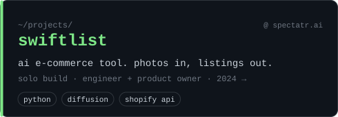</a>
  <a href="https://ujjwal-portfolio-nu.vercel.app">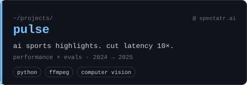</a>
  <a href="https://ujjwal-portfolio-nu.vercel.app">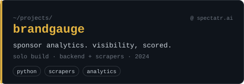</a>
  <a href="https://ujjwal-portfolio-nu.vercel.app">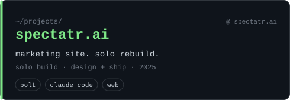</a>
  <a href="https://ujjwal-portfolio-nu.vercel.app">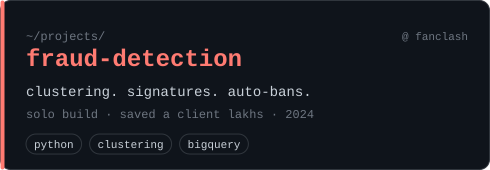</a>
  <a href="https://ujjwal-portfolio-nu.vercel.app">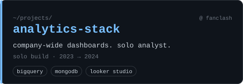</a>

 

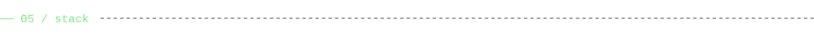

  

 

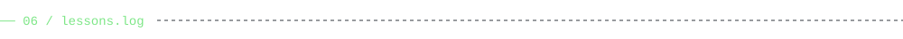

Four years, five jobs, one lesson per job. Each one cost me something to learn.

| job | what it taught me |
| :--- | :--- |
| **ops** · 2021 | The company runs on small reliable loops. If a recurring job dies on a Tuesday, somebody's Monday meeting is wrong. Respect the plumbing. |
| **analyst** · 2023 | Every dashboard is a request for trust. I stopped building big dashboards and started writing answers: one number, one query, one decision. |
| **data scientist** · 2024 | Fraud is a clustering problem more often than a classification problem. You don't always know what you're looking for. Let the shapes show up. |
| **ai engineer** · 2025 | You can't optimise what you can't measure. The eval harness paid for itself the day it shipped. |
| **product owner** · 2026 | The boring part (auth, billing, queues) eats more time than the model. Evals first, vibes second. |

 

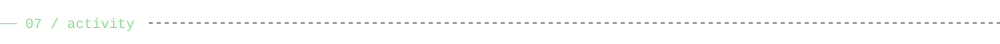

  
    
  <picture>
    <source media="(prefers-color-scheme: dark)" srcset="https://raw.githubusercontent.com/ujjwalsingh-1521/ujjwalsingh-1521/output/github-snake-dark.svg">
    
  </picture>
   
  

